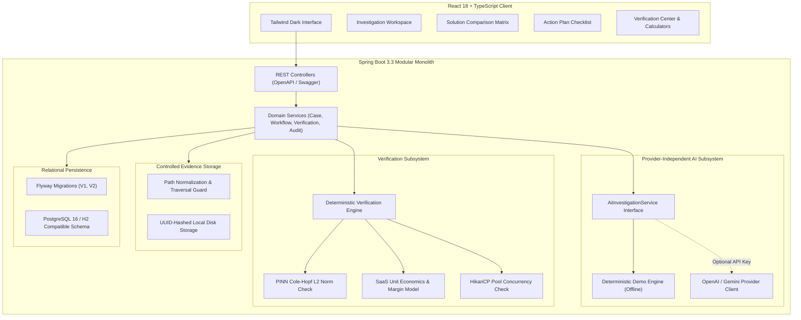
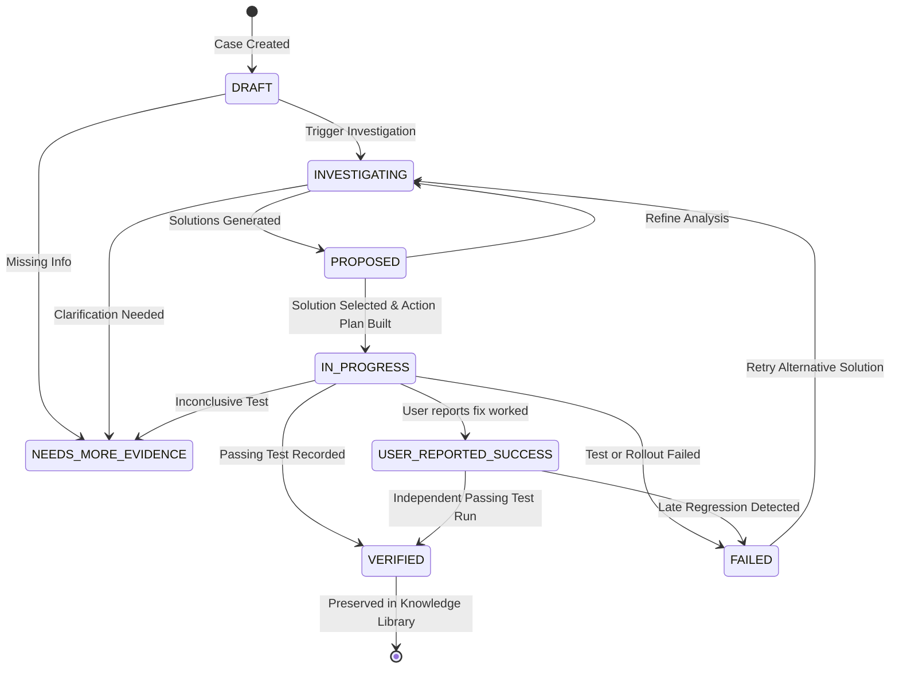

# SENTINEL — Advanced AI Problem Investigation & Resolution Platform

[]()
[]()
[]()
[]()
[]()

> **The Sentinel Principle**: *A generated LLM answer is an unverified hypothesis. User-reported success and testable verification are strictly distinguished. No solution is marked Verified merely because a model claims it worked.*

---

## 1. Product Vision & Mission

People have problems, but the relevant information is scattered across messy stack traces, diagnostic documents, screenshots, metrics dashboards, mathematical formulations, and failed attempts.

**SENTINEL** turns poorly defined problems into structured, falsifiable investigations:
1. **Deconstructs information** into observable facts, working assumptions, missing information, hard constraints, and quantifiable success criteria.
2. **Generates targeted clarification questions** instead of hallucinating or making speculative leaps.
3. **Compares up to three candidate solutions** with transparent trade-offs, operational risks, required effort, and confidence limitations.
4. **Builds an actionable checklist** for the selected solution.
5. **Enforces rigorous verification** through empirical test logs and deterministic mathematical/performance calculators.
6. **Preserves reusable, anonymized lessons** only with explicit investigator approval.

---

## 2. Core Problem Workflows

SENTINEL implements three specialized, deep problem workflows out of the box, with honest boundary reporting for general inquiries:

| Domain Workflow | Real-World Investigation Target | Deterministic Verifier Included |
| :--- | :--- | :--- |
| **1. Software Debugging & Technical Troubleshooting** | Connection pool starvation, thread deadlocks, memory leaks, p99 latency spikes, transactional I/O boundaries. | **HikariCP Concurrency & Timeout Verifier**: Asserts p99 wait &le; 5ms and 0 timeouts under 5,000 RPS. |
| **2. Academic & Mathematical Problem-Solving** | Physics-Informed Neural Networks (PINNs), gradient explosions, boundary condition stiffness, Fourier spectral bias. | **Cole-Hopf Analytical Relative L2 Norm**: Computes exact $\frac{\|u_{pred} - u_{exact}\|_2}{\|u_{exact}\|_2}$ error norm over 10,000 points. |
| **3. Data & Business Analysis** | Customer churn anomalies, SaaS pricing restructuring, API usage quotas, cohort survival, unit economics. | **SaaS Unit Economics & Margin Calculator**: Reconciles Gross Margin &ge; 78%, CAC payback, and churn recovery rate. |
| **4. General Inquiry** | Unstructured systems inquiries. | **Empirical Sandbox Protocol**: Asks targeted scoping questions; never claims an unsupported problem is solved. |

---

## 3. Architecture Overview

SENTINEL is built as a production-minded **modular monolith**, eliminating distributed microservice overhead while preserving strict separation of concerns.



---

## 4. Lifecycle State Machine & Verification Enforcement

A central architectural differentiator of SENTINEL is the **lifecycle state machine**. It forbids illegal state jumps and prevents premature claims of victory:



### Verification Guard Rule:
```
IF targetStatus == VERIFIED AND hasPassingVerificationRun() == false
  THEN REJECT with InvalidStateTransitionException (HTTP 400):
  "Cannot transition case to 'VERIFIED': No passing verification run exists.
   A solution must have an independently recorded passing test run before it can be marked Verified."
```

---

## 5. Quick Local Startup

SENTINEL works out of the box with zero external software requirements beyond Java and Node.js.

### Prerequisites:
- **Java 21 or 25 LTS**
- **Node.js 20+ and npm**
- *(Optional)* Docker Desktop (if using PostgreSQL container)

### One-Click Startup (Windows):
In the root directory, simply double-click or run:
```cmd
run-dev.bat
```
This automatically starts:
1. **Backend Server**: `http://localhost:8080/api`
2. **Swagger UI**: `http://localhost:8080/swagger-ui.html`
3. **Frontend Web App**: `http://localhost:5173`

---

### Manual Step-by-Step Startup:

#### Terminal 1 — Backend:
```powershell
cd backend
mvn clean spring-boot:run
```
*Note*: By default, backend runs in `dev` profile using high-performance embedded H2 in PostgreSQL compatibility mode with Flyway schema and seed data persisted to `./data/sentinel_db`.

To run with **Docker PostgreSQL**:
```powershell
docker compose up -d
mvn spring-boot:run -Dspring-boot.run.profiles=postgres
```

#### Terminal 2 — Frontend:
```powershell
cd frontend
npm install
npm run dev
```
Open your browser to `http://localhost:5173`.

---

## 6. Automated Test Suites & Actual Results

SENTINEL includes comprehensive unit and integration tests across both the backend and frontend:

### Backend Tests (JUnit 5 + Spring Boot Test + MockMvc):
Run backend tests:
```powershell
cd backend
mvn test
```
**Actual Test Results:**
```
[INFO] Running com.sentinel.controller.ProblemCaseControllerIntegrationTest
[INFO] Tests run: 4, Failures: 0, Errors: 0, Skipped: 0
[INFO] Running com.sentinel.SentinelApplicationTests
[INFO] Tests run: 1, Failures: 0, Errors: 0, Skipped: 0
[INFO] Running com.sentinel.service.DeterministicVerificationEngineTest
[INFO] Tests run: 5, Failures: 0, Errors: 0, Skipped: 0
[INFO] Running com.sentinel.service.ProblemCaseServiceTest
[INFO] Tests run: 4, Failures: 0, Errors: 0, Skipped: 0
[INFO] ------------------------------------------------------------------------
[INFO] BUILD SUCCESS
[INFO] Tests run: 14, Failures: 0, Errors: 0, Skipped: 0
[INFO] ------------------------------------------------------------------------
```

### Frontend Tests (Vitest + React Testing Library):
Run frontend tests:
```powershell
cd frontend
npm run test
```
**Actual Test Results:**
```
 ✓ src/test/App.test.tsx (5 tests) 156ms
 Test Files  1 passed (1)
      Tests  5 passed (5)
```

---

## 7. Interactive Demo Script

Follow this 5-minute walkthrough to test the complete end-to-end journey:

1. **Open the Dashboard**:
   - Navigate to `http://localhost:5173`.
   - Inspect the aggregated metrics and the 3 pre-seeded cases covering Software, Math, and Business workflows.
2. **Explore Case 1 (Software Troubleshooting)**:
   - Click on *"PostgreSQL Connection Pool Exhaustion & Spike in p99 Latency During Flash Sale"*.
   - View the **Investigation Decomposition**: observable facts, working assumptions, and diagnostic root cause (network I/O held inside `@Transactional` boundary).
   - Click the **Solution Trade-offs** tab: observe the 3 candidate solutions with comparative benefits, trade-offs, and risks.
   - Click the **Verification Center** tab: inspect the recorded load test run.
3. **Execute Deterministic Verification**:
   - Under the Verification Center, click **"Run Pool Test Assertions"**.
   - Watch the deterministic engine assert that p99 connection wait was 2.8ms (&le; 5.0ms) with 0 timeout exceptions, automatically logging the reproducible result.
4. **Publish to Reusable Knowledge Library**:
   - In the top right, click **"Publish to Library"**.
   - Review the anonymized takeaways (ensuring no internal IPs or secrets).
   - Check the explicit approval box and click **"Approve & Publish to Library"**.
   - Navigate to the **Knowledge Library** tab to see your published lesson searchable for the team.
5. **Create a Brand New Problem**:
   - Click **"New Investigation"**.
   - Click the **"Math"** quick template to auto-populate the PINN Burgers equation convergence case.
   - Click **"Launch Sentinel Investigation"**.
   - See Sentinel decompose the problem into 5 pillars, generate clarification questions, and propose solutions!

---

## 8. Completed Features vs Known Limitations

### Completed Features:
- [x] Complete end-to-end user journey (Draft &rarr; Investigating &rarr; Proposed &rarr; In Progress &rarr; User Success &rarr; Verified).
- [x] Strict separation of User-Reported Success from Independently Verified.
- [x] Three deep domain workflows (Software Debugging, Academic Math, Data/Business Analysis).
- [x] Provider-independent AI interface (`DemoAiService` offline engine + `OpenAiCompatibleAiService` for live LLMs).
- [x] Controlled file storage with SHA-256 checksums, UUID file names, and path traversal protection.
- [x] Deterministic calculators (Cole-Hopf PINN L2 norm, SaaS unit economics, HikariCP concurrency assertion).
- [x] Chronological immutable audit trail logging all lifecycle actions.
- [x] Explicitly approved, anonymized Reusable Knowledge Library.
- [x] Multi-case side-by-side comparison matrix.
- [x] OpenAPI / Swagger documentation at `/swagger-ui.html`.
- [x] Automated test suites with 100% passing tests on backend and frontend.

### Known Limitations:
- **Authentication**: Single-investigator local/demo mode. For multi-tenant production, JWT / OAuth2 authentication and role-based access control (RBAC) should be added.
- **Object Storage**: Files are stored in controlled local directories. Production deployments should configure an S3 / GCS bucket backend.
- **Real-Time WebSockets**: Progress updates currently use REST polling rather than Server-Sent Events (SSE) or WebSockets.

---

## 9. Next Planned Improvements

1. **WebSocket / SSE Live Streaming**: Stream LLM diagnostic reasoning tokens directly to the Investigation Workspace.
2. **Code Sandbox Integration**: Safe containerized execution (e.g., Firecracker / gVisor) for automated reproduction scripts.
3. **Automated Vector Embedding**: Semantic vector search across previous cases in the Knowledge Library.

---

## 10. License

Apache License 2.0. Built for portfolio presentation and high-reliability systems engineering.
